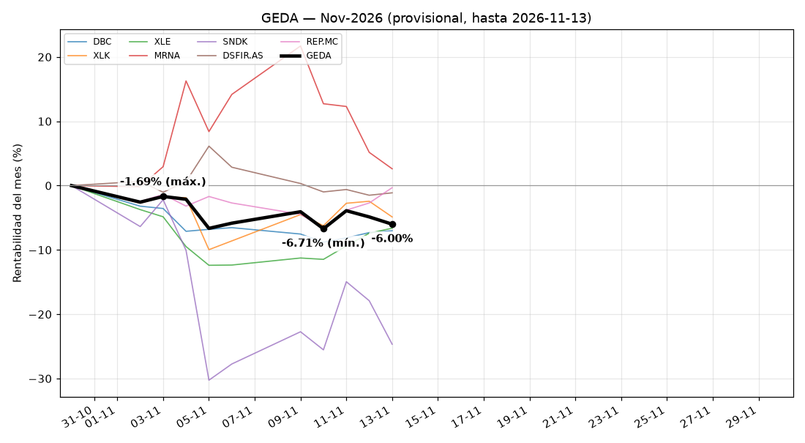

_Datos hasta el cierre del 13-11-2026. Generado el 14-11-2026 19:23 (hora de Madrid). Rentabilidades en EUR, sin comisiones ni impuestos._

<h2>GEDA (en EUR)</h2><table border='1' cellpadding='6' cellspacing='0' style='border-collapse:collapse;'><tr><th>COMPONENTES</th><th>dec-26 (previsión)</th><th>nov-26 (provisional)</th><th>oct-26</th><th>sep-26</th></tr><tr><td><b>Indices</b></td><td style='text-align:center; vertical-align:middle;'>
DBC -
</td><td style='text-align:center; vertical-align:middle;'>
DBC -7.29%
</td><td style='text-align:center; vertical-align:middle;'>
DBC 5.46%
</td><td style='text-align:center; vertical-align:middle;'>
DBC 5.52%
</td></tr><tr><td><b>Sectores</b></td><td style='text-align:center; vertical-align:middle;'>
XLK -

XLE -
</td><td style='text-align:center; vertical-align:middle;'>
XLK -4.00%

XLE -6.11%
</td><td style='text-align:center; vertical-align:middle;'>
XLK -7.00%

XLE 15.46%
</td><td style='text-align:center; vertical-align:middle;'>
XLK 7.38%

XLE -1.16%
</td></tr><tr><td><b>Acciones USA</b></td><td style='text-align:center; vertical-align:middle;'>
MRNA -

SNDK -
</td><td style='text-align:center; vertical-align:middle;'>
MRNA 1.95%

SNDK -22.18%
</td><td style='text-align:center; vertical-align:middle;'>
MRNA 16.76%

SNDK -32.92%
</td><td style='text-align:center; vertical-align:middle;'>
LITE 8.50%

SNDK 13.48%
</td></tr><tr><td><b>Acciones EUROPA</b></td><td style='text-align:center; vertical-align:middle;'>
DSFIR.AS -

REP.MC -
</td><td style='text-align:center; vertical-align:middle;'>
DSFIR.AS -1.08%

REP.MC 0.52%
</td><td style='text-align:center; vertical-align:middle;'>
ASML.AS -11.40%

STMPA.PA -10.67%
</td><td style='text-align:center; vertical-align:middle;'>
ASML.AS 9.99%

STMPA.PA 9.21%
</td></tr><tr style='background-color:#cce5ff;'><td><b>TOTAL</b></td><td style='text-align:center; font-weight:bold; color:#999999;'>-</td><td style='text-align:center; font-weight:bold; color:#FF0000;'>-5.46%</td><td style='text-align:center; font-weight:bold; color:#FF0000;'>-3.47%</td><td style='text-align:center; font-weight:bold; color:#008000;'>7.56%</td></tr></table><h3>Previsión de cambios para dec-26</h3>
<i>Provisional: calculada con datos hasta hoy. Puede cambiar hasta el cierre de mes.</i>
<ul><li><i>Sin cambios previstos para el próximo mes</i></li></ul><h3>Ranking de votos (top 5, máximo 276 por valor)</h3>
<i>✔ = elegido. Margen = votos del último elegido menos los del primero que queda fuera.</i>
<table border='1' cellpadding='6' cellspacing='0' style='border-collapse:collapse;'><tr><th>COMPONENTE</th><th>dec-26 (previsión)</th><th>nov-26 (oficial)</th><th>oct-26</th><th>sep-26</th></tr><tr><td><b>Indices</b></td><td style='vertical-align:top;'>
✔ DBC: 255

VNQ: 15

SPY: 8

AGG: 0

GLD: 0

margen 1º-2º: 240
</td><td style='vertical-align:top;'>
✔ DBC: 272

VNQ: 2

GLD: 1

QQQ: 1

SPY: 1

margen 1º-2º: 270
</td><td style='vertical-align:top;'>
✔ DBC: 243

QQQ: 19

GLD: 14

IWM: 3

SPY: 3

margen 1º-2º: 224
</td><td style='vertical-align:top;'>
✔ DBC: 210

GLD: 38

VGK: 17

QQQ: 12

IWM: 4

margen 1º-2º: 172
</td></tr><tr><td><b>Sectores</b></td><td style='vertical-align:top;'>
✔ XLE: 254

✔ XLK: 185

XLV: 101

XLP: 9

XLF: 3

margen 2º-3º: 84
</td><td style='vertical-align:top;'>
✔ XLE: 267

✔ XLK: 216

XLV: 67

XLP: 2

XLB: 0

margen 2º-3º: 149
</td><td style='vertical-align:top;'>
✔ XLK: 269

✔ XLE: 228

XLV: 54

XLC: 2

XLF: 1

margen 2º-3º: 174
</td><td style='vertical-align:top;'>
✔ XLK: 259

✔ XLE: 256

XLF: 23

XLV: 17

XLI: 10

margen 2º-3º: 233
</td></tr><tr><td><b>Acciones USA</b></td><td style='vertical-align:top;'>
✔ MRNA: 216

✔ SNDK: 170

ACN: 49

MU: 49

DELL: 27

margen 2º-3º: 121
</td><td style='vertical-align:top;'>
✔ MRNA: 192

✔ SNDK: 180

MU: 55

DELL: 39

LITE: 37

margen 2º-3º: 125
</td><td style='vertical-align:top;'>
✔ SNDK: 200

✔ MRNA: 87

DELL: 81

LITE: 79

MU: 60

margen 2º-3º: 6 ⚠️ AJUSTADO
</td><td style='vertical-align:top;'>
✔ SNDK: 209

✔ LITE: 110

DELL: 90

MU: 58

MRNA: 39

margen 2º-3º: 20 ⚠️ AJUSTADO
</td></tr><tr><td><b>Acciones EUROPA</b></td><td style='vertical-align:top;'>
✔ REP.MC: 209

✔ DSFIR.AS: 106

WKL.AS: 83

STMPA.PA: 64

HOT.DE: 39

margen 2º-3º: 23 ⚠️ AJUSTADO
</td><td style='vertical-align:top;'>
✔ REP.MC: 228

✔ DSFIR.AS: 122

STMPA.PA: 78

HOT.DE: 44

SAP.DE: 35

margen 2º-3º: 44
</td><td style='vertical-align:top;'>
✔ STMPA.PA: 155

✔ ASML.AS: 114

REP.MC: 97

DSFIR.AS: 71

MB.MI: 55

margen 2º-3º: 17 ⚠️ AJUSTADO
</td><td style='vertical-align:top;'>
✔ STMPA.PA: 167

✔ ASML.AS: 91

DSFIR.AS: 77

MB.MI: 67

SPM.MI: 47

margen 2º-3º: 14 ⚠️ AJUSTADO
</td></tr></table>

<h3>Rentabilidad diaria de Nov-2026 (provisional)</h3>

