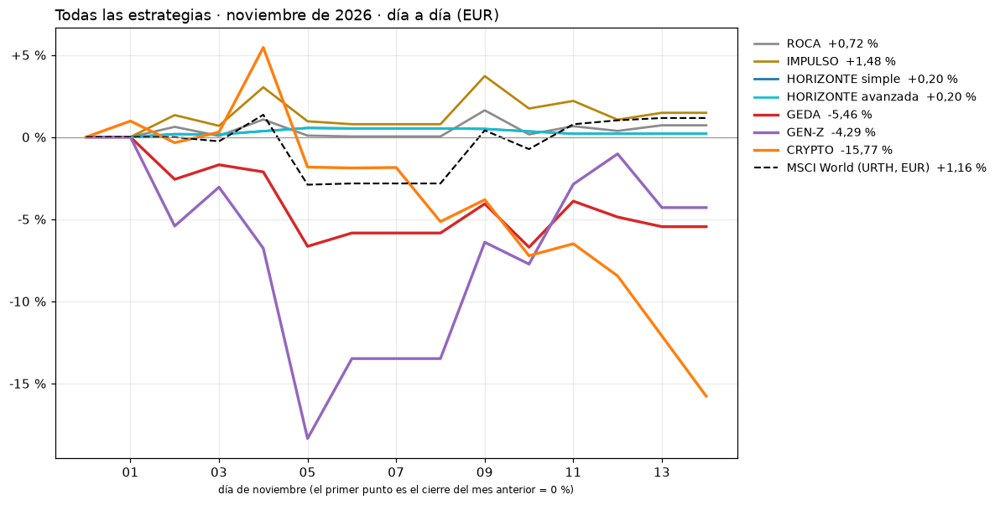

# TuAmigoInversor · todas las estrategias
Ejecutado el 14-11-2026 19:25 (Madrid) · último cierre con datos: 14-11-2026 · nov-26 provisional · EUR

> ⚠️ **Avisos**
> - Motor: Sin datos en Yahoo, se excluyen: ['AABA', 'ABMD', 'ADS', 'AET', 'AGN', 'ALTR', 'ALXN', 'ANDV', 'ANSS', 'ARG', 'ARNC', 'ATVI', 'AVP', 'BCR', 'BRCM', 'BXLT', 'CA', 'CCE', 'CELG', 'CERN', 'CFN', 'CHK', 'CMA', 'CMCSK', 'COL', 'COV', 'CPGX', 'CTLT', 'CTRA', 'CTRX', 'CTXS', 'CVC', 'CXO', 'DAY', 'DFS', 'DISH', 'DNB', 'DNR', 'DO', 'DRE', 'DTV', 'ENDP', 'ESRX', 'ESV', 'ETFC', 'EVHC', 'FBHS', 'FDO', 'FL', 'FLIR', 'FRC', 'FTR', 'GAS', 'GGP', 'GMCR', 'GPS', 'HAR', 'HBI', 'HCBK', 'HES', 'HFC', 'HOLX', 'HOT', 'HSP', 'IPG', 'JNPR', 'JOY', 'JWN', 'K', 'KORS', 'KRFT', 'KSU', 'LLL', 'LLTC', 'LM', 'LMCA', 'LMCK', 'LO', 'LSXMA', 'LSXMK', 'LVLT', 'MJN', 'MNK', 'MON', 'MRO', 'MWV', 'MXIM', 'NBL', 'NLSN', 'PBCT', 'PCP', 'PDCO', 'PETM', 'PLL', 'PXD', 'QEP', 'QRTEA', 'RAI', 'RHT', 'RTN', 'SCG', 'SEE', 'SGEN', 'SHPG', 'SIAL', 'SIVB', 'SNI', 'SPLK', 'SRCL', 'STJ', 'SWN', 'SWY', 'TEG', 'TGNA', 'TIF', 'TSS', 'TWC', 'TWTR', 'TWX', 'VAR', 'WBA', 'WCG', 'WFM', 'WIN', 'WRK', 'WYND', 'XEC', 'XL', 'XLNX', 'YHOO']
> - Motor: Sin datos en Yahoo, se excluyen: ['ABE.MC', 'ABG-P.MC', 'ALU.PA', 'ATC.AS', 'ATL.MI', 'BKIA.MC', 'BME.MC', 'BOKA.AS', 'BP.MI', 'BPSO.MI', 'CNHI.MI', 'CRH.L', 'DL.AS', 'EDF.PA', 'FTI.PA', 'GLPG.AS', 'GTO.AS', 'JAZ.MC', 'JDEP.AS', 'LHN.PA', 'LUX.MI', 'MAS.MC', 'PMI.MI', 'POP.MC', 'SGRE.MC', 'TKWY.AS', 'TL5.MC', 'TNTE.AS', 'UBI.MI', 'US.MI', 'VTSC.DE', 'WDI.DE', 'YNAP.MI']

| Estrategia | Perfil | Mes en curso | Mejor | Peor | Posiciones del mes | Previsión dic-26 |
|---|---|---:|---:|---:|---|---|
| **ROCA** | Conservador | **+0,72 %** | +1,63 % | +0,00 % | DODLX, IAU, MIXAX, VHGEX, VIPSX, VSIAX | Pesos fijos (revisión en enero y julio) |
| **IMPULSO** | Moderado | **+1,48 %** | +3,71 % | +0,00 % | IAU, VHGEX, VSIAX | Pesos fijos (revisión en enero y julio) |
| **HORIZONTE simple** | Moderado | **+0,20 %** | +0,55 % | +0,00 % | 0P0000142P.F | Renta fija (S&P -0,7 % sobre su WMA 150) · sin cambios |
| **HORIZONTE avanzada** | Moderado | **+0,20 %** | +0,55 % | +0,00 % | 0P0000142P.F | Renta fija (S&P -0,7 % sobre su WMA 150) · sin cambios |
| **GEDA** | Agresivo | **-5,46 %** | +0,00 % | -6,71 % | DBC, DSFIR.AS, MRNA, REP.MC, SNDK, XLE, XLK | sin cambios previstos · ⚠️ Acciones EUROPA AJUSTADO |
| **GEN-Z** | Muy agresivo | **-4,29 %** | +0,00 % | -18,35 % | AMD, CRL, CRWD, MU | sin cambios previstos · ⚠️ Acciones GEN-Z AJUSTADO |
| **CRYPTO** | Especulativo | **-15,77 %** | +5,45 % | -15,77 % | BTC-USD, ETH-USD | Pesos fijos (revisión en enero y julio) |
| MSCI World (URTH, EUR) | | **+1,16 %** | | | | |

## Informes de cada estrategia

- [GEDA](../informe/README.md)
- [GEN-Z](../informe_genz/README.md)
- [ROCA · IMPULSO · CRYPTO](../informe_fijas/README.md)
- [HORIZONTE](../informe_horizonte/README.md)