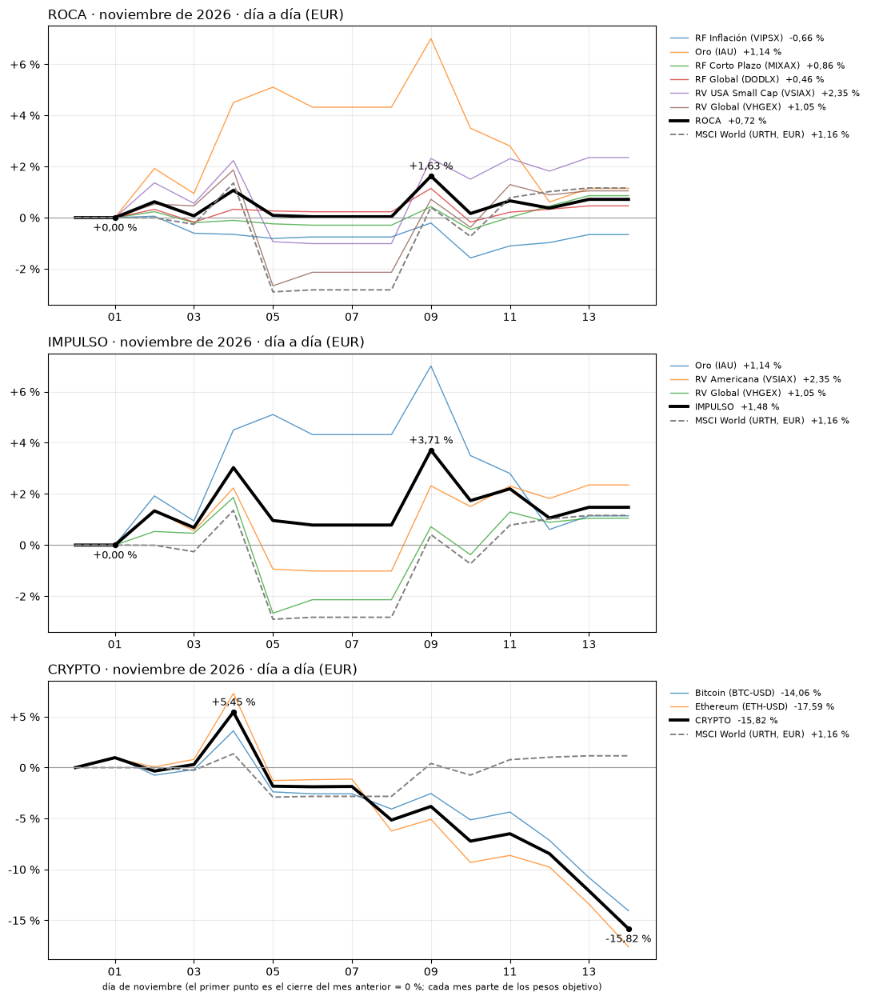

# ROCA · IMPULSO · CRYPTO · seguimiento diario
Ejecutado el 14-11-2026 19:23 (Madrid) · último cierre con datos: 14-11-2026 · rentabilidades en EUR

**nov-26 (provisional):** ROCA +0,72 % · IMPULSO +1,48 % · CRYPTO -15,82 % · MSCI World (URTH, EUR) +1,16 %

## 1. Resumen

| Mes | ROCA | IMPULSO | CRYPTO | MSCI World (URTH, EUR) |
|---|---:|---:|---:|---:|
| **ago-26** (cerrado) | **1,37 %** | **4,10 %** | **28,10 %** | **2,10 %** |
| **sep-26** (cerrado) | **-0,76 %** | **-2,75 %** | **9,94 %** | **0,92 %** |
| **oct-26** (cerrado) | **1,56 %** | **-0,45 %** | **-10,44 %** | **0,63 %** |
| **nov-26** (provisional) | **0,72 %** | **1,48 %** | **-15,82 %** | **1,16 %** |
| **Acumulado meses cerrados** | 2,18 % | 0,78 % | 26,12 % | 3,69 % |

## 2. Noviembre de 2026, día a día

### ROCA · Conservador

ROCA: ha llegado a ir +1,63 % el 9 y su peor momento ha sido +0,00 % el 1. Va en +0,72 %.

| Activo | Ticker | Peso | Rentab. del mes |
|---|---|---:|---:|
| RF Inflación | VIPSX | 20 % | -0,66 % |
| Oro | IAU | 15 % | +1,14 % |
| RF Corto Plazo | MIXAX | 25 % | +0,86 % |
| RF Global | DODLX | 15 % | +0,46 % |
| RV USA Small Cap | VSIAX | 10 % | +2,35 % |
| RV Global | VHGEX | 15 % | +1,05 % |

### IMPULSO · Moderado

IMPULSO: ha llegado a ir +3,71 % el 9 y su peor momento ha sido +0,00 % el 1. Va en +1,48 %.

| Activo | Ticker | Peso | Rentab. del mes |
|---|---|---:|---:|
| Oro | IAU | 40 % | +1,14 % |
| RV Americana | VSIAX | 30 % | +2,35 % |
| RV Global | VHGEX | 30 % | +1,05 % |

### CRYPTO · Especulativo

CRYPTO: ha llegado a ir +5,45 % el 4 y su peor momento ha sido -15,82 % el 14. Va en -15,82 %.

| Activo | Ticker | Peso | Rentab. del mes |
|---|---|---:|---:|
| Bitcoin | BTC-USD | 50 % | -14,06 % |
| Ethereum | ETH-USD | 50 % | -17,59 % |

_Cada mes parte de los pesos objetivo y no rebalancea dentro del mes. Uso interno: no es una recomendación._