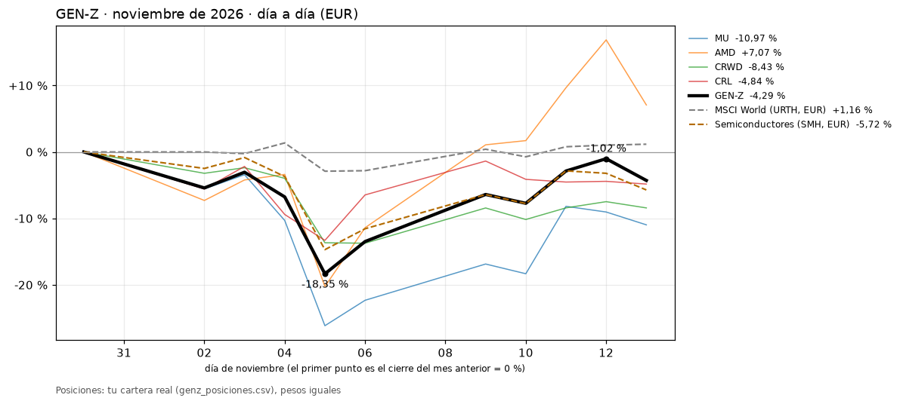

# GEN-Z · seguimiento diario
Ejecutado el 14-11-2026 18:54 (Madrid) · último cierre con datos: 13-11-2026 · rentabilidades en EUR

**nov-26 (provisional): -4,29 %** · MSCI World (URTH, EUR): +1,16 % · Semiconductores (SMH, EUR): -5,72 %

**Previsión para dic-26:** AMD (SEMICONDUCTORES), CRL (SALUD_IA), CRWD (SOFTWARE_CIBER), MU (SEMICONDUCTORES) → sin cambios previstos

> ⚠️ **Avisos**
> - AJUSTADO (margen 1 votos entre el 4º y el 5º)
> - genz_temas_etf.csv está vacío: la previsión de dic-26 NO incluye robótica/IA ni cuántica por cartera de ETF. Pega ahí la foto de BOTZ y WQTM (ticker,tema).
> - Tickers sin cotizar en los últimos 10 días (su precio queda congelado): {'QRVO': datetime.date(2026, 10, 2)}

## 1. Noviembre de 2026, día a día

Ha llegado a ir -1,02 % el 12 de noviembre y su peor momento ha sido -18,35 % el 5 de noviembre. Va en -4,29 %.

| Tema | Ticker | Nombre | Peso | Rentab. del mes |
|---|---|---|---:|---:|
| SEMICONDUCTORES | **AMD** | Advanced Micro Devices, Inc. | 25,0 % | +7,07 % |
| SALUD_IA | **CRL** | Charles River Laboratories Inte | 25,0 % | -4,84 % |
| SOFTWARE_CIBER | **CRWD** | CrowdStrike Holdings, Inc. | 25,0 % | -8,43 % |
| SEMICONDUCTORES | **MU** | Micron Technology, Inc. | 25,0 % | -10,97 % |

Posiciones: tu cartera real (genz_posiciones.csv), pesos iguales. Tu cartera real: -4,29 % · método: -4,29 % en nov-26.

## 2. Resumen

| Mes | Estado | Versión | GEN-Z | MSCI World (URTH, EUR) | Semiconductores (SMH, EUR) |
|---|---|---|---:|---:|---:|
| **ago-26** | cerrado | v2 publicado | **-2,55 %** | 2,10 % | 2,40 % |
| **sep-26** | cerrado | v2 publicado | **29,38 %** | 0,92 % | 11,80 % |
| **oct-26** | cerrado | v2 publicado | **-33,00 %** | 0,63 % | -12,99 % |
| **nov-26** | provisional (hasta el 13-nov) | definitiva (cartera real) | **-4,29 %** | 1,16 % | -5,72 % |
| **dic-26** | previsión de posiciones | definitiva | **—** | — | — |
| **Acumulado 3 meses cerrados** | | | **-15,53 %** | 3,69 % | -0,39 % |

## 3. Votos de la versión definitiva (top 5 y elegidas; ✔ = elegida; máximo 2 por tema)

**nov-26 (mes en curso)** · máximo 276 votos · margen 4º-5º: 19 ⚠️ AJUSTADO

| | Ticker | Tema | Votos |
|---|---|---|---:|
| ✔ | 1º MU | SEMICONDUCTORES | 224 |
| ✔ | 2º AMD | SEMICONDUCTORES | 216 |
|  | 3º INTC | SEMICONDUCTORES | 164 |
|  | 4º MRVL | SEMICONDUCTORES | 117 |
| ✔ | 5º CRL | SALUD_IA | 98 |

**dic-26 (previsión)** · máximo 276 votos · margen 4º-5º: 1 ⚠️ AJUSTADO

| | Ticker | Tema | Votos |
|---|---|---|---:|
| ✔ | 1º AMD | SEMICONDUCTORES | 204 |
| ✔ | 2º MU | SEMICONDUCTORES | 197 |
| ✔ | 3º CRWD | SOFTWARE_CIBER | 145 |
|  | 4º INTC | SEMICONDUCTORES | 115 |
| ✔ | 5º CRL | SALUD_IA | 114 |

## 4. Meses cerrados publicados (v2)

| Mes | Posiciones publicadas | GEN-Z publicado | Comprobación Yahoo |
|---|---|---:|---:|
| **ago-26** | FORM -5,80 % · LRCX 2,31 % · TER -5,39 % · INTC -1,33 % | **-2,55 %** | -2,55 % |
| **sep-26** | FORM 51,65 % · LRCX 11,46 % · TER 17,15 % · INTC 37,26 % | **29,38 %** | 29,38 % |
| **oct-26** | FORM -40,55 % · AMD -16,32 % · TER -30,60 % · INTC -44,53 % | **-33,00 %** | -33,00 % |

_La previsión se calcula como si el mes terminase hoy y puede cambiar hasta el cierre. Uso interno: no es una recomendación de inversión._