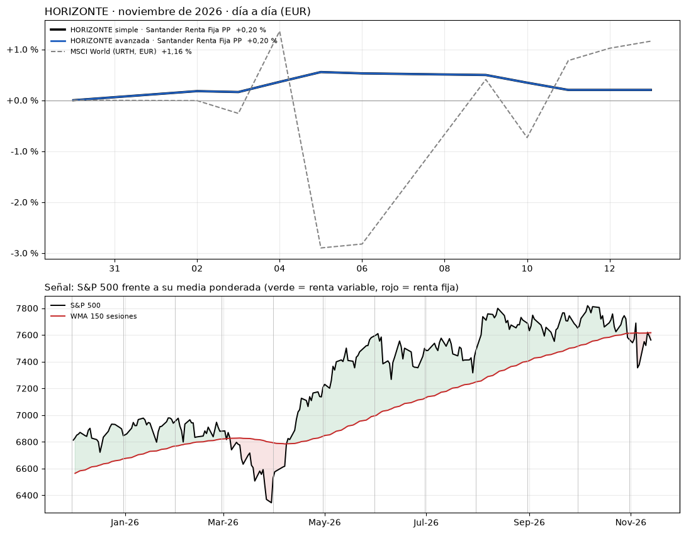

# HORIZONTE · seguimiento diario
Ejecutado el 14-11-2026 19:10 (Madrid) · último valor liquidativo: 13-11-2026 · rentabilidades en EUR

**nov-26 (provisional):** HORIZONTE simple +0,20 % · HORIZONTE avanzada +0,20 % · MSCI World (URTH, EUR) +1,16 %

**Planes este mes:** HORIZONTE simple: Santander Renta Fija PP (0P0000142P.F) · HORIZONTE avanzada: Santander Renta Fija PP (0P0000142P.F)

**Previsión para dic-26:** Renta fija: el S&P 500 está 0,7 % por debajo de su WMA 150 (cierre del 13-11). Sin cambios.

## 1. Noviembre de 2026 y la señal

## 2. Resumen

| Mes | Señal | HORIZONTE simple | HORIZONTE avanzada | MSCI World (URTH, EUR) |
|---|---|---:|---:|---:|
| **ago-26** (cerrado) | Renta variable (S&P +3,3 % sobre la media) | **2,43 %** | **3,17 %** | **2,10 %** |
| **sep-26** (cerrado) | Renta variable (S&P +3,8 % sobre la media) | **-0,62 %** | **6,66 %** | **0,92 %** |
| **oct-26** (cerrado) | Renta variable (S&P +1,8 % sobre la media) | **-1,24 %** | **-5,58 %** | **0,63 %** |
| **nov-26** (provisional) | Renta fija (S&P -0,4 % sobre la media) | **0,20 %** | **0,20 %** | **1,16 %** |
| **Acumulado meses cerrados** | | 0,53 % | 3,90 % | 3,69 % |

_Señal con el cierre del último día de cada mes. Uso interno: no es una recomendación de inversión._